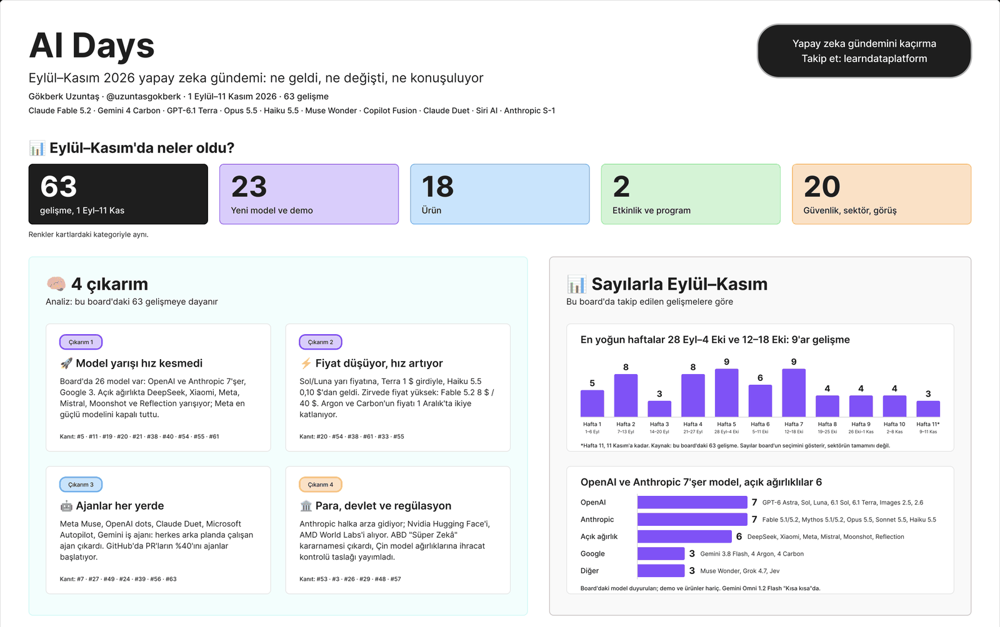

# AI Days

**AI Days**, yapay zeka gündemini bölüm bölüm tek bir dokümanda topladığım Türkçe bir seri: son haftalarda ne geldi,
ne değişti, ne konuşuluyor. Her gelişme bir kart; kartlar model, ürün, program ve büyük resim başlıklarında, kaynaklarıyla.
Bölümleri [LearnDataPlatform](https://www.meetup.com/learndataplatform/) topluluğunda çevrim içi anlatıyorum. Bu repo dokümanların kalıcı adresi.

*English: AI Days is a Turkish series that collects the AI news of recent weeks into one document of cards (new
models, products and programmes, the big picture), each with its sources. Episodes are presented online in the
LearnDataPlatform community; this repository is the permanent home of the documents.*

## Bölümler

| # | Dönem | Doküman | Tam yayın |
|---|---|---|---|
| 7 | 1 Eylül–11 Kasım 2026 · 63 gelişme | [özet](bolumler/07-eylul-kasim-2026/README.md) · [PDF](bolumler/07-eylul-kasim-2026/ai-days-07-eylul-kasim-2026.pdf) | [YouTube](https://youtu.be/vYXhWvymFHo) |

Repo 7. bölümle başladı; her yeni bölüm `bolumler/<no>-<dönem>/` altına kendi özetiyle eklenir.

## Bir bölümde ne var

- **Özet:** kategori sayıları, 4 çıkarım, haftalık yoğunluk ve dönemin takvimi.
- **Kartlar:** her gelişme için tarih, duyuran hesap, kategori (yeni model, demo, ürün, program, etkinlik, güvenlik,
  sektör, görüş), öne çıkan bilgi ve kaynak linkleri.
- **Kısa kısa ve takipte:** kartlara girmeyen ama bilmeye değer başlıklar, yaklaşan tarihler.
- **Sohbet köşesi:** yayında birlikte konuştuğumuz sorular.

## Kaynak ve doğruluk

Dokümandaki kural: tarihler duyuru tarihidir (ABD saati), X'te Türkiye saatiyle bir gün sonra görünebilir.
@uzuntasgokberk paylaşımları dışındaki kartlar resmi sayfalar ve en az iki haber kaynağıyla doğrulanır; kaynaklar
kartların altındadır. Sayılar dokümanın seçimini gösterir, sektörün tamamını değil.

Yanlış bir tarih, sayı ya da kaynak görürsen [Düzeltme](https://github.com/uzuntasgokberk/ai-days/issues/new?template=duzeltme.md) şablonuyla issue aç.
Bir sonraki bölüme girmesini istediğin bir gelişme için [Gündem önerisi](https://github.com/uzuntasgokberk/ai-days/issues/new?template=gundem-onerisi.md)
şablonunu kullan.

## Katkı

Issue'lar açık, pull request'ler davetle: [CONTRIBUTING.md](CONTRIBUTING.md). Kişisel veri ya da yanlışlıkla
paylaşılmış bir bilgi görürsen herkese açık issue açma: [SECURITY.md](SECURITY.md).

## Lisans

Dokümanlar [Creative Commons Attribution 4.0 International (CC BY 4.0)](LICENSE) ile paylaşılır: kullanabilir,
uyarlayabilir ve paylaşabilirsin; atıf şart ([NOTICE](NOTICE)). Kartlarda geçen ürün, şirket ve model adları
sahiplerinin markalarıdır; kartlardaki özetler kaynak linklerindeki yayınlara dayanır.

## Yazar

Gökberk Uzuntaş · Microsoft MVP (Data Platform) · LinkedIn, YouTube, Instagram ve TikTok'ta **@uzuntasgokberk**
