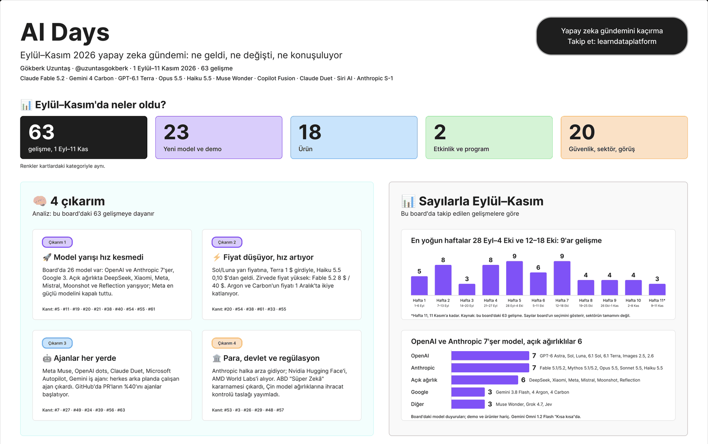

# AI Days 7. bölüm: Eylül–Kasım 2026 yapay zeka gündemi

**1 Eylül–11 Kasım 2026 · 63 gelişme.** 11 Kasım 2026'da LearnDataPlatform topluluğunda çevrim içi anlatıldı.
Hazırlayan ve sunan: Gökberk Uzuntaş.

📑 [Dokümanın tamamı (PDF)](ai-days-07-eylul-kasim-2026.pdf) · 📺 [Tam yayın: YouTube @uzuntasgokberk](https://www.youtube.com/@uzuntasgokberk)

## Sayılarla

| Gelişme | Yeni model ve demo | Ürün | Etkinlik ve program | Güvenlik, sektör, görüş |
|---:|---:|---:|---:|---:|
| **63** | 23 | 18 | 2 | 20 |

En yoğun haftalar 28 Eylül–4 Ekim ve 12–18 Ekim: 9'ar gelişme. OpenAI ve Anthropic 7'şer model duyurdu; açık
ağırlıklı modeller 6.

## 4 çıkarım

1. **Model yarışı hız kesmedi.** Board'da 26 model var: OpenAI ve Anthropic 7'şer, Google 3. Açık ağırlıkta DeepSeek,
   Xiaomi, Meta, Mistral, Moonshot ve Reflection yarışıyor; Meta en güçlü modelini kapalı tuttu.
2. **Fiyat düşüyor, hız artıyor.** Sol/Luna yarı fiyatına, Terra 1 $ girdiyle, Haiku 5.5 0,10 $'dan geldi. Zirvede
   fiyat yüksek: Fable 5.2 8 $ / 40 $. Argon ve Carbon'un fiyatı 1 Aralık'ta ikiye katlanıyor.
3. **Ajanlar her yerde.** Meta Muse, OpenAI dots, Claude Duet, Microsoft Autopilot, Gemini iş ajanı: herkes arka planda
   çalışan ajan çıkardı. GitHub'da PR'ların %40'ını ajanlar başlatıyor.
4. **Para, devlet ve regülasyon.** Anthropic halka arza gidiyor; Nvidia Hugging Face'i, AMD World Labs'i alıyor. ABD
   "Süper Zekâ" kararnamesi çıkardı, Çin model ağırlıklarına ihracat kontrolü taslağı yayımladı.

Her çıkarımın dayandığı kart numaraları dokümanda ("Kanıt" satırı).

## Dokümanın bölümleri

- **Eylül–Kasım'da neler oldu:** sayılar, 4 çıkarım, haftalık yoğunluk, hafta hafta takvim
- **Yeni modeller:** Claude Fable 5.1 ve 5.2, Opus 5.5, Sonnet 5.5, Haiku 5.5, Gemini 4 Argon ve Carbon, GPT-6 Astra,
  Sol, Luna ve Terra, açık ağırlıklı modeller
- **Ürün, program ve etkinlik:** Claude Design, Slides ve Docs, GitHub Copilot Fusion, Claude Duet, Claude Code
  güncellemeleri, GitHub Dev Days İstanbul
- **Büyük resim:** güvenlik, iş gücü, sektör, politika ve regülasyon
- **Kısa kısa ve takipte:** kartlara girmeyenler, yaklaşan tarihler
- **Sohbet köşesi:** yayında konuştuğumuz 12 soru

## Yayının akışı

Zamanlar YouTube'daki tam yayına göre.

| Zaman | Konu |
|---|---|
| 00:00 | Giriş |
| 00:48 | Eylül–Kasım: 63 gelişme |
| 02:21 | Yeni modeller |
| 12:06 | Ürün, program ve etkinlik |
| 20:24 | Büyük resim: sektör, güvenlik ve politika |
| 27:19 | Geliştirici araçları |
| 31:31 | Kısa kısa |
| 32:11 | Soru-cevap |
| 32:28 | Junior geliştiriciler 2026'da ne yapmalı? |
| 34:03 | Fiyatlar düşerken hangi işleri agent'lara devredersiniz? |
| 34:39 | Yapay zeka çağında dil öğrenmek |
| 39:51 | Son ayların en faydalı özellikleri: Claude Design ve GitHub Copilot Fusion |
| 41:25 | Agent harness |
| 42:43 | Kapanış |

Yayında bahsettiğim agent harness yapısının Power BI ve BI projeleri için açık kaynak hali:
[analytics-agent-harness](https://github.com/uzuntasgokberk/analytics-agent-harness).

## Not

Kartlar 11 Kasım 2026 itibarıyla hazırlandı; "henüz doğrulanmadı" diye işaretlenen bilgiler o tarihte resmi kaynakla
teyit edilmemiş iddialardır. Sayılar dokümanın seçimini gösterir, sektörün tamamını değil.
